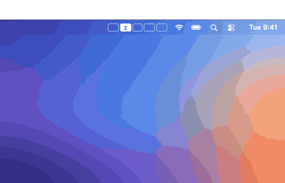
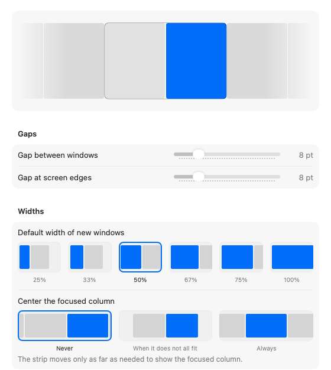

# Macousel

Macousel is a native Mac app whose window management runs on [Paneru](https://github.com/karinushka/paneru), an open-source scrolling window manager written in Rust. Macousel adds the settings window, the menu bar indicator, the minimap, the overview, app shortcuts, and a URL scheme. Paneru moves the windows.

Every window is a column on one horizontal strip. The strip is wider than your screen, so you scroll it. Opening a window never resizes the ones you already have.

It is the model niri and PaperWM use on Linux, built as a native Mac app.



## Status

Early. I wrote it on macOS 27 with two displays. The parts that talk to macOS have had little real use so far, so expect bugs and please report them.

Paneru runs as a child process of the app. Macousel writes its configuration, starts it, and stops it when you pause, quit, or switch engines. The older engine I wrote in Swift is still in the app. You can switch back to it in Settings > General.

## What it does

**The strip**

- New windows open next to the focused one.
- Focus moves with the keyboard, and the strip scrolls just far enough to show the window.
- Each display and each Space has its own strip.
- With displays side by side, a window scrolled toward the other display waits on the free side of its own display.
- Column order and widths come back after a restart.

**Columns**

- Stack several windows in one column and resize the rows.
- Turn a stack into a tabbed column. Paneru shows one window at a time and has no tab bar.
- Cycle a column through preset widths, or nudge it wider and narrower.
- Float a window to take it out of the strip.

**Input**

- Every shortcut can be rebound. One action can have several shortcuts.
- Give an app its own key in Settings > App shortcuts. The key focuses its window, cycles through its windows when you press it again, and opens the app if it is not running.
- Swipe with three or four fingers, or hold Control-Option and scroll.
- A swipe moves one column at a time. Keep swiping to move further. Settings > Pointer has a free-scrolling mode if you prefer Paneru's own swipe.
- Optional focus follows mouse and mouse follows focus.

**The rest**

- A minimap of the strip that appears when focus moves, and a column count in the menu bar.
- An overview that shows every window in the strip, stacks included. Pick one to focus it, or drag a card to reorder columns or stack it onto another window. Shift plus an arrow key or a number moves the selected window.
- Drag a cell in the minimap to reorder and stack the same way.
- Drag a real window by its title bar. A preview shows where it will land, between two columns, at either end of the strip, or on the top or bottom half of another window. Release and Paneru moves the window there.
- A focus border and dimming for inactive windows.
- Per-app rules: float, open at a set width, or open in a set column.
- A URL scheme and a command line client for scripts.
- Quitting or pausing stops Paneru, which centres every window on its display.
- Settings panes show a live preview. Choices with a picture, like the default width or the menu bar style, are picked by clicking the picture.



Macousel reads the column structure from Paneru through a small bridge helper, so stacks, tabbed columns, and columns parked off screen all map to the right column. Dropping a window on a tabbed column adds it as the last tab. The overview and minimap draw a tabbed column as one column with a row per tab.

With "Center the focused column" on, the strip centers on the dropped window after a drag.

## What the built-in engine still offers

Paneru does not do these. The built-in engine does, and Macousel greys out the matching settings while Paneru is selected.

- A tab bar for tabbed columns.
- Move a window straight to column 1 to 9.
- Tiling off for one display, and the display under the pointer becoming the active one.
- The scratchpad.
- Floating windows that return to the front when you focus a tiled window.
- Resize columns and rows in the overview.
- Putting every window back at its original frame when you quit or pause.

Switch engines in Settings > General. Macousel stops one and starts the other without a relaunch.

## Requirements

- macOS 14 or later.
- Accessibility permission. macOS only lets an app move other apps' windows through the Accessibility API. It is the only permission Macousel asks for, and Paneru runs under it as a child of the app.
- No other copy of Paneru running. Two window managers would both move your windows, so Macousel shows a message and does not start its own.

## Install

Run the installer. It downloads the latest release, puts `Macousel.app` in `/Applications`, and replaces an older copy:

```sh
curl -fsSL https://github.com/nmbrthirteen/macousel/releases/latest/download/install.sh | bash
```

With Homebrew:

```sh
brew tap nmbrthirteen/macousel https://github.com/nmbrthirteen/macousel
brew install --cask macousel
```

Or download `Macousel.dmg` from the [releases page](https://github.com/nmbrthirteen/macousel/releases) and drag the app to Applications.

Then open Macousel. A short guide walks you through Accessibility access, the first shortcuts, and the menu bar item.

### Updating

Open Settings > About and click "Check for updates". Macousel checks once a day on its own, and you can turn that off in Settings > General. You can also run the installer again. After either one, macOS asks for Accessibility access again, because every release has a new signature.

Macousel only installs an update whose archive carries a valid signature from my update signing key. If the check fails, nothing is installed.

After an update, Macousel shows that release's notes once.

### Uninstall

1. Turn off "Launch at login" in Settings > General.
2. Quit Macousel from its menu.
3. Delete `/Applications/Macousel.app`.
4. Delete its data:

   ```sh
   rm -rf ~/Library/Application\ Support/Macousel ~/Library/Logs/Macousel
   defaults delete dev.macousel.app
   ```

5. Remove Macousel from System Settings > Privacy & Security > Accessibility.

With Homebrew, `brew uninstall --zap macousel` does steps 3 and 4.

### The app is not notarized

I do not have an Apple Developer ID. Releases are signed with a certificate of my own, which macOS does not recognise. Two things follow from that:

- If you used the DMG or Homebrew, macOS blocks the first launch. Open System Settings > Privacy & Security and click "Open Anyway". The installer script clears the quarantine flag, so it skips this step.
- The Accessibility grant is tied to that certificate, so it carries over from one release to the next. Releases up to 0.1.4 were signed ad hoc, so the first update from one of them asks for access once more.

Updates are verified with a signing key that I hold, and the app is not notarized. The signature proves an update came from me. It does not replace Apple's notarization.

### Build from source

You need Xcode's command line tools and Rust. Install Rust from [rustup.rs](https://rustup.rs).

```sh
git clone https://github.com/nmbrthirteen/macousel.git
cd macousel
scripts/bundle.sh
open build/Macousel.app
```

`scripts/bundle.sh` calls `scripts/engine.sh`, which builds the Paneru version pinned in `support/engine-version` into `build/engine-<version>/` and prints the path of the binary. It downloads the Paneru source from crates.io, checks it against the checksum in `engine-bridge/Cargo.lock`, and applies the patches in `support/engine-patches`. The first build takes two to three minutes. Later runs reuse the binary. The same script builds `engine-bridge`, a small Rust program that asks Paneru for its column structure and prints it as JSON. The bundle script copies both to `Contents/Helpers` and signs them before it signs the app.

For a development build with `swift run`, run `scripts/engine.sh` once. Macousel finds the binary in `build/` when the app has no bundled helper.

To keep the Accessibility grant across your own rebuilds, sign with a certificate from your keychain:

```sh
CODESIGN_IDENTITY="My Certificate" scripts/bundle.sh
```

## Default shortcuts

Most of them use Control-Option, including the column numbers. Plain Option plus a digit would block characters on layouts such as German, where Option-5 to Option-9 type brackets and braces. Rebind any of them in Settings > Shortcuts. A shortcut you already changed keeps its binding.

Paneru handles the keys itself through an event tap. Macousel registers only the pause and overview keys and your app shortcuts. A key that Paneru has no name for stays in Settings but is not sent to Paneru, and its row says so.

Two columns of two stacked windows make a 2 by 2 grid. I build one by stacking each window onto the column on its left.

| Action | Keys |
| --- | --- |
| Focus left, down, up, right | ⌃⌥ H J K L, or the arrows |
| Move the window | ⌃⌥⇧ and the same keys |
| First or last window | ⌃⌥⌘ ← → |
| Jump to column 1 to 8, or 9 for the last | ⌃⌥ 1 to 9 |
| Move the window to the first or last spot | ⌃⌥⌘⇧ ← → |
| Cycle width, full width, center | ⌃⌥ R, F, C |
| Wider, narrower | ⌃⌥ = and - |
| Taller, shorter, equalize | ⌃⌥⇧ = and -, ⌃⌥ 0 |
| Stack with the column on the left | ⌃⌥ ] or [ |
| Pop out to its own column on the right | ⌃⌥⇧ ] or [ |
| Tabbed column | ⌃⌥⇧ T |
| Float | ⌃⌥ T |
| Send to the next display | ⌃⌥ N |
| Overview | ⌃⌥ O |
| Pause tiling | ⌃⌥ Q |

Paneru only stacks a window onto the column on its left, so both stack shortcuts do the same thing. Both pop-out shortcuts do too. Move to column 1 to 9 (⌃⌥⇧ 1 to 9) and the scratchpad shortcuts need the built-in engine.

## What Macousel stores and sends

Layout restore keeps the app identifiers and a hash of each window title in the app's preferences. It never stores a title in plain text. Nothing is sent anywhere, except two requests to GitHub: the update check once a day, which you can turn off in Settings > General, and the download when you install an update.

## Reporting a problem

Choose "Save diagnostics…" from the menu bar icon. It writes one text file to your Desktop with the app's log, your settings, your displays, the names of any crash reports, and the names of any apps that respond slowly. It also holds the selected engine, the Paneru version, the state of the engine process, the configuration Macousel wrote for it, and the last 200 lines of the engine log. Attach it to the issue.

The engine log is `~/Library/Logs/Macousel/engine.log`. It rotates at 1 MB and keeps one previous file.

## Scripting

Every action has a command name. With Paneru selected, Macousel forwards each engine action to the engine. List them:

```sh
build/Macousel.app/Contents/MacOS/Macousel list
```

Run one from the command line or through the URL scheme:

```sh
build/Macousel.app/Contents/MacOS/Macousel focus-left
open "macousel://cycle-width"
```

Write a Raycast script command for every action:

```sh
build/Macousel.app/Contents/MacOS/Macousel raycast-scripts ~/raycast-scripts
```

### Settings file

Export all settings to a JSON file and load them on another Mac:

```sh
build/Macousel.app/Contents/MacOS/Macousel export-settings ~/macousel-settings.json
build/Macousel.app/Contents/MacOS/Macousel import-settings ~/macousel-settings.json
```

The file holds a format version and your preferences with sorted keys, so you can edit it by hand. Fields you leave out keep their defaults. Settings > General has the same two buttons.

## Development

```sh
swift build
swift test
```

The package has three targets:

- `StripCore` is the layout engine of the built-in engine. It is pure Swift with no AppKit, and it holds most of the engine tests.
- `WindowSystem` wraps the Accessibility API, hotkeys, displays, and gestures.
- `Macousel` is the app: both engines, settings, and overlays. `sources/macousel/engine/` runs and configures Paneru.

`swift build` and `swift test` do not need Rust. Only the bundle does.

The code has no comments. Names carry the meaning.

### Releasing

Push a version tag. The release workflow runs the tests, builds the app with that version, signs the zip with the update key, attests build provenance, and publishes `Macousel.dmg`, `Macousel.zip`, `Macousel.zip.sig`, and `install.sh` to a GitHub release. The release notes list the SHA-256 sums of the DMG and the zip.

The workflow installs a pinned Rust toolchain and caches the engine build, keyed on the version in `support/engine-version` and the patches. To move to a newer Paneru, change that file, rebase the patches, and read the new release's configuration notes first.

The workflow reads the base64 private key from the `UPDATE_SIGNING_KEY` repository secret. To sign a zip by hand:

```sh
UPDATE_SIGNING_KEY="..." swift scripts/sign-update.swift build/Macousel.zip build/Macousel.zip.sig
```

```sh
git tag v0.1.0
git push origin v0.1.0
```

To build the same files locally:

```sh
VERSION=0.1.0 scripts/bundle.sh
scripts/package.sh
```

The DMG layout lives in `support/installer`. `scripts/package.sh` builds it with [dmgbuild](https://github.com/dmgbuild/dmgbuild), which it installs into `build/dmg-tools` on the first run.

### Private APIs

Macousel uses a few private macOS calls. Every Mac window manager needs the same ones, and they rule out the Mac App Store.

- `_AXUIElementGetWindow` maps an Accessibility element to a window ID.
- `CGSManagedDisplayGetCurrentSpace` reads the active Space of a display.
- `_SLPSSetFrontProcessWithOptions` and `SLPSPostEventRecordTo` focus one window without raising the whole app. If they stop working, Macousel falls back to normal app activation.
- `MultitouchSupport` reads raw trackpad touches for the swipe gesture.

## License

Macousel is MIT. See [LICENSE](LICENSE).

The bundled Paneru engine is MIT too, copyright Karinushka. Its license is in `support/licenses/paneru-license.txt`. The crates it links against are listed with their licenses in `support/licenses/third-party-notices.txt`. Both files sit in `Macousel.app/Contents/Resources`, and Settings > About has a button that opens that folder.
